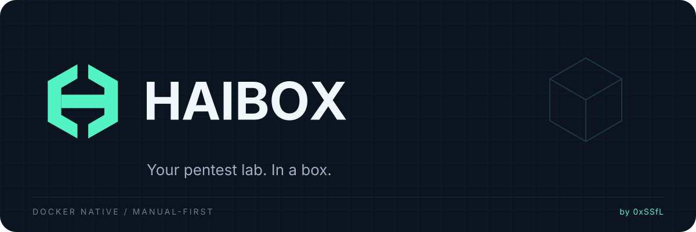

<p align="center">
  
</p>

<h1 align="center">HAIBOX</h1>

<p align="center">
  A Docker-based pentesting workstation. Manual-first. Built for your lab.
</p>

<p align="center">
  <a href="#quick-start">Quick start</a> &middot;
  <a href="#choose-your-toolkit">Toolkits</a> &middot;
  <a href="#everyday-commands">Commands</a> &middot;
  <a href="#security-and-current-limits">Security</a> &middot;
  <a href="docs/user-guide.md">Documentation</a>
</p>

**HAIBOX puts your security tools, workspaces, and testing sessions in one place.**
Choose a Docker image, create an engagement, and open your terminal. An
*engagement* is a separate testing project with its own scope, container,
network, and persistent workspace.

HAIBOX has its own CLI and image definitions. It runs directly with Docker on
Linux; a VM is optional, not a requirement.

> [!IMPORTANT]
> **Alpha software.** The default runner network has no external connectivity.
> VPN traffic routing, a VPN kill switch, and AI integration are not available
> yet. GUI forwarding is not implemented; an internal Xpra proof of concept is
> not a supported command or feature. Current image scans contain unresolved
> HIGH/CRITICAL findings. See the [current limits](#security-and-current-limits)
> before running target-facing work.

## What you get

- **Choose your tools:** Core, Web, Network, Active Directory, OSINT, or Full images.
- **Keep work organized:** separate engagements and persistent workspaces, with
  an interactive menu, shell access, and one-off commands.
- **Keep a record:** host-side evidence, SHA-256 manifests, and hash-chained audit
  logs, plus image build, verification, and scanning commands.

## Quick start

### 1. Install HAIBOX

```bash
curl -fsSL https://0xssfl.github.io/haibox/install.sh | bash
```

The installer bootstraps `uv`, verifies the release checksum, and installs the
`haibox` command with `uv tool install`. You need **Linux, Docker Engine 28+,
and Git**. Image builds need internet access.

To work from source instead:

```bash
git clone https://github.com/0xSSfL/haibox.git
cd haibox
uv sync --locked --extra dev
```

Review the [host Docker notes](docs/host-docker-review.md) before running your
first workload. Access to a rootful Docker daemon is highly privileged.

### 2. Set up Docker and HAIBOX

For a local rootful Docker installation, create this client-side context once:

```bash
docker context create haibox --docker "host=unix:///var/run/docker.sock"
haibox init
haibox doctor
```

If you installed from source, prefix commands with `uv run` (for example,
`uv run haibox init`).

Already have a `haibox` context? Inspect its endpoint with
`docker context inspect haibox` instead of recreating it. **A named context does
not create a separate Docker daemon or isolate your host.** For a different
endpoint, follow the [user guide](docs/user-guide.md).

### 3. Build a toolkit

Start with the Web Security image:

```bash
uv run haibox image build web-security
uv run haibox image verify web-security
```

Verification checks that the tools execute; it does **not** mean the image is
free of vulnerabilities. With Trivy or Grype installed, review its scan:

```bash
uv run haibox image scan web-security
```

The scan exits non-zero when HIGH/CRITICAL findings remain, the scanner fails,
or the scanner cannot cover the image OS. Trivy runs first; when Trivy does not
scan the image's packages (Fedora, Arch Linux), HAIBOX falls back to Grype. An
empty or unsupported report is never treated as a clean pass. Do not treat a
failed scan as a security approval. Current results are recorded in the
[image catalog](docs/image-catalog.md).

### 4. Try an offline session

This demo checks your setup without scanning a target. Its empty scope denies
all targets in the scope matcher; it is not a replacement for network controls.

```bash
uv run haibox engagement init demo \
  --name "Offline demo" \
  --profile web-security \
  --allow-empty-scope

uv run haibox run -- nmap --version
uv run haibox shell
```

Inside the container, save your files under **`/workspace`**. Type `exit` to
return to your host, then stop the runner when you are done:

```bash
uv run haibox container stop
```

Your workspace remains available when you reopen the session. To set up an
actual lab engagement, use the [user guide](docs/user-guide.md) and define only
targets you are authorized to test. Adding a target to scope does not make it
reachable: the default runner can communicate with containers on its own
engagement network, not external websites, your LAN, or host services.

## Choose your toolkit

| Image / profile | Intended use | Status |
|---|---|---|
| `core` | Shell, file utilities, and basic network triage | Active |
| `web-security` | Web assessment with tools such as Nmap, Nuclei, ffuf, and sqlmap | Active |
| `network-security` | Network discovery, DNS, and packet inspection | Active |
| `ad-security` | Authorized Active Directory assessment | Experimental |
| `osint` | Public-source, DNS, and metadata tooling | Experimental |
| `full` | Combined Web, Network, AD, and OSINT toolkit | Experimental |

All six have recorded build and tool-verification results. **Active does not
mean vulnerability-free**, and image selection does not change the isolated
network default. See the [image catalog](docs/image-catalog.md) for tool lists,
image dependencies, versions, and scan results.

```bash
uv run haibox image list
uv run haibox image build core
```

## Everyday commands

Run these from the cloned repository. Commands without an engagement ID use
the current engagement.

| Task | Command |
|---|---|
| Open the interactive menu | `uv run haibox tui` |
| Show your environment | `uv run haibox info` |
| List your engagements | `uv run haibox engagement list` |
| Select an engagement | `uv run haibox engagement use demo` |
| Open its shell | `uv run haibox shell` |
| Run one command | `uv run haibox run -- nmap --version` |
| Show its scope | `uv run haibox scope show` |
| Stop its container | `uv run haibox container stop` |
| Check stored evidence | `uv run haibox evidence verify` |
| Show available commands | `uv run haibox --help` |

By default, each engagement's files live under
`~/.local/share/haibox/engagements/<id>/`. Only `workspace/` is mounted writable
in the runner. Evidence, reports, secrets, and audit logs remain on the host.
Stopping a container preserves the workspace; **destroying an engagement deletes
its stored data**.

## Security and current limits

Runner defaults include a non-root user, a read-only root filesystem, restricted
mounts, and an internal network with isolated gateway mode. All capabilities
are dropped before any profile-approved additions. Runners do not receive the
Docker socket, host networking, or privileged mode.

These defaults reduce exposure; **they are not a guarantee against container
escape or a substitute for authorization**. The Docker host remains trusted.

| Area | Current limitation |
|---|---|
| Scope | The matcher checks policy; it does not enforce target/port allowlists at the network layer. |
| External targets | The default runner has no internet or external DNS access. Scoped external connectivity is planned. |
| VPN | Profile storage and gateway lifecycle code exist, but the gateway image has not been built. Runner routing and the kill switch are not implemented. |
| AI | The restricted Docker broker and AI adapter are not implemented. Manual use does not require AI. |
| GUI / desktop | No `haibox gui` commands or supported native-window feature. A Fedora X11 Xpra proof of concept is documented in [verification status](docs/verification-status.md); its disposable image is unscanned, and other Linux distributions and Wayland remain unverified. |
| Image security | Unresolved dependency vulnerabilities keep the scan gate open. |
| Secrets and records | Secrets are plaintext at rest with file permissions. Hashes and audit chains are not tamper-proof against a trusted host user or administrator. |

Use HAIBOX only on systems you own or have explicit permission to assess.
For the full trust model and limitations, read [SECURITY.md](SECURITY.md) and
the [threat model](docs/threat-model.md).

## Documentation

| Start here | What you will find |
|---|---|
| [User guide](docs/user-guide.md) | Setup, concepts, and full command reference |
| [Image catalog](docs/image-catalog.md) | Tools, profiles, image dependencies, and scan baselines |
| [Verification status](docs/verification-status.md) | The project's recorded tests and runtime checks |
| [Image validation](docs/image-validation.md) | Build, scan, and suppression-validation evidence |
| [Host Docker review](docs/host-docker-review.md) | Host impact and isolation checks |
| [Architecture](docs/architecture.md) | How the platform fits together |
| [Roadmap](docs/roadmap.md) | Current milestone and future work |

## Contributing

Read [CONTRIBUTING.md](CONTRIBUTING.md). To run the development checks:

```bash
uv sync --locked --extra dev
uv run pytest
uv run ruff check .
uv run mypy src
```

Unit tests use a fake runtime. Docker integration tests are opt-in; follow the
[integration test guide](tests/integration/README.md) before enabling them.
Report security concerns as described in [SECURITY.md](SECURITY.md).

## License

HAIBOX is [MIT licensed](LICENSE). Bundled third-party tools retain their own
licenses; see the [image licensing notes](docs/image-catalog.md#licensing-notes).

---

Built by **[0xSSfL](https://github.com/0xSSfL)**.
