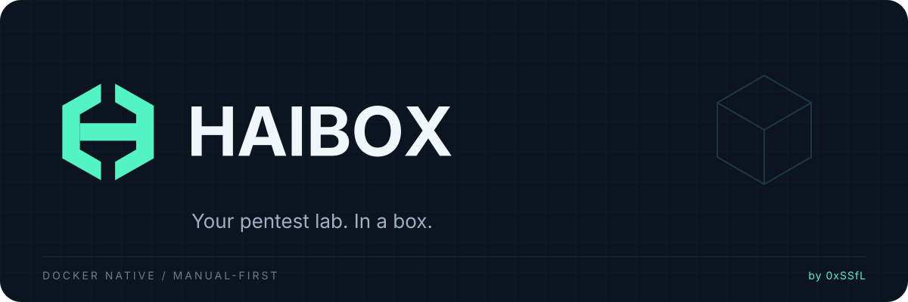

---
hide:
  - navigation
  - toc
---

<div class="hero" markdown>
{ .hero-banner }

# Your pentest lab. In a box.

**HAIBOX puts your security tools, workspaces, and testing sessions in one
place.** Choose a Docker image, create an engagement, and open your terminal.
An *engagement* is a separate testing project with its own scope, container,
network, and persistent workspace.

[Get started](user-guide.md){ .md-button .md-button--primary }
[View on GitHub](https://github.com/0xSSfL/haibox){ .md-button }
</div>

## Install in one command

```bash
curl -fsSL https://0xssfl.github.io/haibox/install.sh | bash
```

The installer bootstraps `uv` when needed, verifies the release checksum, and
installs the `haibox` command with `uv tool install`. You need Linux, Docker
Engine 28+, and a dedicated `haibox` Docker context.

```bash
docker context create haibox --docker "host=unix:///var/run/docker.sock"
haibox init
haibox doctor
```

Already have a `haibox` context? Inspect it instead of recreating it. A named
context does **not** create a separate Docker daemon or isolate your host.

## What you get

<div class="grid cards" markdown>

- :material-docker: **Choose your tools**

    Core, Web, Network, Active Directory, OSINT, or Full images, each with a
    pinned tool manifest and a verification command.

- :material-folder-lock: **Keep work organized**

    Separate engagements and persistent workspaces, with an interactive menu,
    shell access, and one-off commands.

- :material-file-document-check: **Keep a record**

    Host-side evidence, SHA-256 manifests, and hash-chained audit logs, plus
    image build, verification, and scanning commands.

- :material-shield-lock: **Deny by default**

    Non-root runners, read-only root filesystems, restricted mounts, dropped
    capabilities, and an isolated network profile.

</div>

## Build a toolkit

```bash
haibox image build web-security
haibox image verify web-security
haibox image scan web-security
```

Verification checks that the tools execute; it does **not** mean the image is
free of vulnerabilities. The scan gate is currently open on dependency
findings. See the [image catalog](image-catalog.md) for recorded baselines.

## Security and current limits

HAIBOX is alpha software. The default runner network has no external
connectivity. VPN routing, a VPN kill switch, and AI integration are not
available yet. The `scoped` network profile is a prototype: the nftables policy
covers the forward path, not host services or Docker embedded DNS, and negative
integration tests are still missing.

These defaults reduce exposure; **they are not a guarantee against container
escape or a substitute for authorization**. Use HAIBOX only on systems you own
or have explicit permission to assess. Read [SECURITY.md](https://github.com/0xSSfL/haibox/blob/main/SECURITY.md)
and the [threat model](threat-model.md).

## Documentation

| Start here | What you will find |
|---|---|
| [User guide](user-guide.md) | Setup, concepts, and full command reference |
| [Image catalog](image-catalog.md) | Tools, profiles, image dependencies, and scan baselines |
| [Verification status](verification-status.md) | Recorded tests and runtime checks |
| [Architecture](architecture.md) | How the platform fits together |
| [Roadmap](roadmap.md) | Current milestone and future work |
