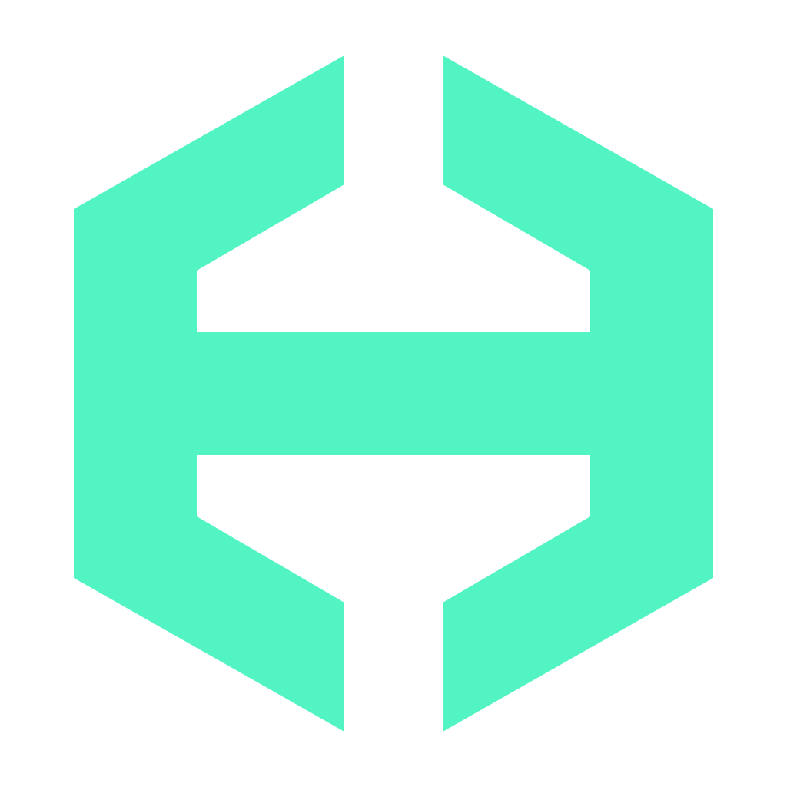

---
hide:
  - navigation
  - toc
---

<section class="hb-landing" aria-labelledby="hb-hero-title">
  

    

      
 HAIBOX / 0.1.0 alpha / Docker-native

      <h1 id="hb-hero-title" class="hb-hero-title">Your pentest lab.In a box.</h1>
      

        Six curated security toolkits. Separate engagement workspaces.
        A practical, manual-first workstation for authorized security testing,
        with isolated networking by default.
      

      

        <a class="hb-btn hb-btn-primary" href="user-guide/">Get started &#8594;</a>
        <a class="hb-btn hb-btn-secondary" href="#toolkits">Explore toolkits</a>
        <a class="hb-btn hb-btn-secondary" href="https://github.com/0xSSfL/haibox" target="_blank" rel="noopener noreferrer">GitHub &#8599;</a>
      

      

        <svg viewBox="0 0 16 16" aria-hidden="true"><path d="m3 8 3 3 7-7"/></svg> Docker on Linux
        <svg viewBox="0 0 16 16" aria-hidden="true"><path d="m3 8 3 3 7-7"/></svg> Persistent workspaces
        <svg viewBox="0 0 16 16" aria-hidden="true"><path d="m3 8 3 3 7-7"/></svg> 6 toolkits
      

    

    

      

      

        

        

          

          

          

          

          

          

        

      

      

        

          <i></i><i></i><i></i>
          haibox / local workstation
          DEMO
        

        

          
# Illustrative workflow (not live output)

          
$haibox doctor

          
&gt; review Docker context and host requirements

          
$haibox image build web-security

          
&gt; builds a pinned toolkit image locally

          
$haibox engagement init demo --profile web-security --allow-empty-scope

          
&gt; create an offline lab workspace

          
$haibox shell 

        

        
Offline by default &middot; illustrative demo &middot; no commands executed

      

      
<button class="hb-motion-toggle" type="button" aria-pressed="false" hidden>Pause animation</button>

    

  

  
&#9888;<strong>Alpha release.</strong> External target routing and VPN/AI integration are unfinished, and image dependency scans still contain HIGH/CRITICAL findings. <a href="verification-status/">View verification status</a>.

</section>

---

  
Security Architecture

  <h2 class="section-title">Built for Isolation. Verified by Default.</h2>
  
HAIBOX enforces strict trust boundaries between your host, tool runners, and target networks.

  

    

      
    

    <h3>Deny-by-Default Runners</h3>
    
Non-root user (UID 65534), read-only root filesystem, dropped capabilities, no privileged mode, and no Docker socket pass-through.

  

  

    

      
    

    <h3>Host-Only Data Boundary</h3>
    
Secrets, evidence, reports, and audit logs live exclusively on the host. Only <code>workspace/</code> is mounted writable inside the runner.

  

  

    

      
    

    <h3>Tamper-Evident Audit Trail</h3>
    
Every container lifecycle event, shell session, and command execution is logged to a hash-chained SHA-256 host ledger with instant verification.

  

  

    

      
    

    <h3>Isolated Network Default</h3>
    
Default engagements run on Docker isolated gateway mode. Zero external connectivity, preventing accidental packet leakage to LAN or internet.

  

---

  
Curated Toolkits

  <h2 class="section-title">Choose Your Security Toolkit</h2>
  
Six reproducible image variants built with pinned manifests, Debian snapshots, and tool verification checks.

  <!-- Core -->
  

    

      

        


        <h3>core</h3>
      

      Active
    

    
Base container with minimal triage utilities, shell environment, and diagnostic tools.

    
Included Tools

    

      bash
      curl
      netcat
      socat
      jq
      file
    

    
haibox image build core

  

  <!-- Web Security -->
  

    

      

        


        <h3>web-security</h3>
      

      Active
    

    
Complete web penetration testing suite for reconnaissance, scanning, and fuzzing.

    
Included Tools

    

      nmap
      nuclei
      ffuf
      sqlmap
      dalfox
      nikto
      httpx
    

    
haibox image build web-security

  

  <!-- Network Security -->
  

    

      

        


        <h3>network-security</h3>
      

      Active
    

    
Layer 3/4 packet inspection, network discovery, service fingerprinting, and DNS analysis.

    
Included Tools

    

      tcpdump
      tshark
      nmap
      masscan
      bind9-dnsutils
    

    
haibox image build network-security

  

  <!-- AD Security -->
  

    

      

        


        <h3>ad-security</h3>
      

      Experimental
    

    
Authorized Active Directory assessment, Kerberos authentication triage, and attack-path enumeration.

    
Included Tools

    

      bloodhound-python
      impacket
      kerbrute
      netexec
    

    
haibox image build ad-security

  

  <!-- OSINT -->
  

    

      

        


        <h3>osint</h3>
      

      Experimental
    

    
Public intelligence gathering, domain reconnaissance, metadata harvesting, and email enumeration.

    
Included Tools

    

      theHarvester
      sherlock
      sublist3r
      dnsrecon
      photon
    

    
haibox image build osint

  

  <!-- Full -->
  

    

      

        


        <h3>full</h3>
      

      Experimental
    

    
Comprehensive toolkit bundling Web, Network, Active Directory, and OSINT capabilities into one image.

    
Included Tools

    

      all toolkits
      nuclei
      impacket
      tshark
      ffuf
    

    
haibox image build full

  

---

  
Quick Start

  <h2 class="section-title">Up and Running in 3 Steps</h2>
  
Get your isolated penetration testing environment initialized in minutes.

  

    

      
    

    <h3>1. Install HAIBOX</h3>
    
Install via the verified release script using <code>uv tool install</code>:

    
curl -fsSL https://0xssfl.github.io/haibox/install.sh | bash

  

  

    

      
    

    <h3>2. Setup Docker Context</h3>
    
Create the client-side context and verify host prerequisites:

    
docker context create haibox --docker "host=unix:///var/run/docker.sock" && haibox init && haibox doctor

  

  

    

      
    

    <h3>3. Launch an Engagement</h3>
    
Initialize a workspace and open an interactive isolated shell:

    
haibox engagement init demo --profile web-security --allow-empty-scope && haibox shell

  

  

    
  

  

    <h4>Alpha Software Notice & Security Boundaries</h4>
    

      The default runner network has no external connectivity. Scope matchers check policy before execution;
      they are not a replacement for network-layer enforcement. Use HAIBOX only on systems you own or have explicit,
      written authorization to assess. Review <a href="threat-model.md">Threat Model</a> and <a href="https://github.com/0xSSfL/haibox/blob/main/SECURITY.md" target="_blank" rel="noopener">SECURITY.md</a>.
    

  

  <a href="user-guide.md" class="btn-primary" style="font-size: 1.05rem; padding: 0.85rem 2.2rem;">
     Read the Full Documentation
  </a>

